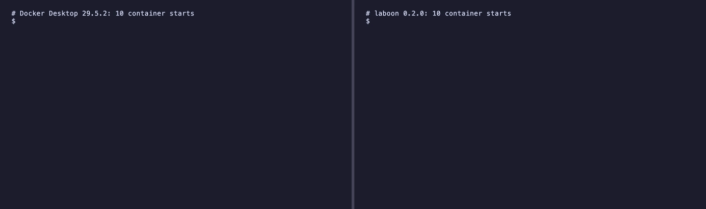
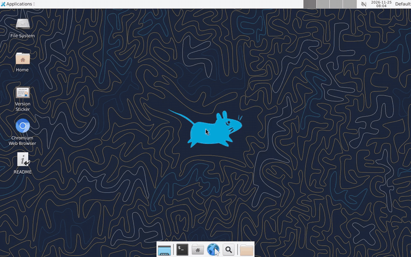

<p align="center">
  
</p>

<p align="center">
  <a href="https://github.com/samyfodil/laboon/actions/workflows/ci.yml"></a>
  <a href="https://github.com/samyfodil/laboon/releases/latest"></a>
  <a href="https://pkg.go.dev/github.com/samyfodil/laboon"></a>
  <a href="LICENSE"></a>
  
  
</p>

**Run untrusted Linux programs and containers safely, with no VM, on Linux, macOS, and Windows.**

<p align="center">
  
</p>
<p align="center"><sub>Ten <code>alpine:3.20</code> container starts on an Apple M4, warm image, recorded one side at a time: Docker Desktop 29.5.2 in 1.95 s, laboon 0.2.0 in 0.18 s.</sub></p>

<p align="center">
  
</p>
<p align="center"><sub>An E2B-style desktop inside laboon on Linux, with no VM: XFCE on Xvfb in <code>accetto/ubuntu-vnc-xfce-chromium-g3</code>, driven by <code>xdotool</code> and recorded by <code>ffmpeg</code> in the same sandbox. Chromium runs as a regular user with its own sandbox on.</sub></p>

laboon runs unmodified Linux binaries and OCI containers with the guest's
machine code executing natively on the host CPU. It intercepts only syscall
instructions: a supervisor emulates the Linux ABI, with no second kernel or
instruction emulator. This is the syscall-interception class of design, like
gVisor. Native execution means no VM on any supported host, and a guest runs
on a host of its own architecture, amd64 or arm64. The exception is an Apple
Silicon Mac, which also runs x86-64 guests, translated by Rosetta.

Isolation has **two independent layers**: supervisor mediation through a
confined filesystem with no direct host paths, a fixed device allowlist, and
networking off by default with configurable egress allowlists; plus the
host-OS sandbox (seccomp / Seatbelt / AppContainer) as a kill-on-escape
backstop. Give each untrusted program or agent-generated command a disposable
sandbox, exposing only the files and network access it needs.

Use it as a standalone binary, behind a container client, through MCP, or
embedded in your own program. The same Linux guest behavior is provided across
Linux, macOS, and Windows, subject to the documented
[platform limits](docs/permissions-and-limits.md). laboon is newer, with a small host
surface by design; its daemon and OCI runtime should not be read as claims
of production maturity or complete engine compatibility.

<p align="center">
  <picture>
    <source media="(prefers-color-scheme: dark)" srcset="docs/assets/architecture-dark.svg">
    
  </picture>
</p>

[Install](#install) · [Get started](#get-started) · [Ways to run it](#ways-to-run-it) ·
[How it works](#how-it-works) · [Performance](#performance) ·
[AI agents and desktop sandboxes](#ai-agents-and-desktop-sandboxes)

## Install

**Homebrew** (macOS, Linux):

```sh
brew install samyfodil/laboon/laboon
```

**Scoop** (Windows):

```powershell
scoop bucket add laboon https://github.com/samyfodil/scoop-laboon
scoop install laboon
```

Prebuilt binaries for every platform are on the
[latest release](https://github.com/samyfodil/laboon/releases/latest). To embed
laboon as a Go library:

```sh
go get github.com/samyfodil/laboon
```

## Ways to run it

| Interface | Use it when… | Entry point |
|---|---|---|
| **Standalone CLI / binary** | You want to run a program or image directly, with no daemon. | [`cmd/laboon`](cmd/laboon/main.go): `laboon -image <ref> <cmd>` |
| **Docker-API-compatible daemon** | You want a Docker or Moby client to drive sandboxes. It serves the Docker Engine API; each container runs as a laboon sandbox, without a second kernel. | [`cmd/laboond`](cmd/laboond/main.go) |
| **OCI runtime** | You want a runc/crun drop-in for Docker, containerd, Podman, or CRI-O. Register it with your engine; Docker selects it with `docker run --runtime=laboon …`. | [`cmd/laboon-runtime`](cmd/laboon-runtime/main.go) |
| **MCP server** | You want an AI agent to call a `run` tool and receive the exit status, stdout, and stderr. Supports stdio and streamable HTTP server mode. | [`cmd/laboon-mcp`](cmd/laboon-mcp/main.go) |
| **Go library** | You want to embed the sandbox in your own program, with no daemon. | `go get github.com/samyfodil/laboon`, then `laboon.RunImage` |

The daemon and OCI runtime are separate integrations: one serves clients,
the other runs bundles supplied by an existing engine. Selecting laboon as
an OCI runtime does not remove an engine's own host-platform requirements.

## Get started

To build from source, you need Go 1.27.1 or newer on Linux, macOS, or Windows,
on amd64 or arm64.
The per-platform stubs are committed: importing or building laboon needs
neither Zig nor CGo. The first image run also needs host access to its OCI
registry; later runs use the cached image unless `WithPull` requests a refresh.
Image fetching is separate from the guest's network permissions.

### Run an image with the CLI

Download and extract the [repository source](https://github.com/samyfodil/laboon/archive/refs/heads/main.zip),
then open a terminal in the extracted repository directory:

```sh
go build ./cmd/laboon
./laboon -image alpine:3.20 cat /etc/os-release
```

On Windows, invoke `.\laboon.exe` instead of `./laboon`. The command prints
Alpine's release information, including `ID=alpine`, and exits successfully.
The guest has the image's filesystem and no external network access. Once
installed on your PATH, the command is `laboon -image alpine:3.20 cat /etc/os-release`.

### Embed a sandbox in Go

In a new directory outside the source checkout, create a Go module:

```sh
mkdir laboon-hello
cd laboon-hello
go mod init example.com/laboon-hello
go get github.com/samyfodil/laboon
```

Save this as `main.go`:

```go
package main

import (
	"context"
	"os"

	"github.com/samyfodil/laboon"
)

func main() {
	code, err := laboon.RunImage(context.Background(), "alpine:3.20",
		laboon.WithArgs("echo", "hello from laboon"),
		laboon.WithStdout(os.Stdout),
		laboon.WithStderr(os.Stderr),
	)
	if err != nil {
		panic(err)
	}
	os.Exit(code)
}
```

Run it:

```sh
go run .
```

The guest prints `hello from laboon` and exits successfully. It has the image's
filesystem and no external network access. Output is connected explicitly
because the library discards stdout and stderr by default.

Use `laboon.Run` for a Linux ELF binary instead of an image. Without `WithRoot`,
the binary is loaded from a host path and the guest's `/` is an empty private
tree holding only that binary, so it must be static; `WithRoot` supplies a root
directory. See [options.go](options.go) for argument,
mount, environment, image-cache, and I/O options, and the
[Go reference](https://pkg.go.dev/github.com/samyfodil/laboon) for the API.

## What runs under it

The tested workload set includes the following. These are exercised workloads,
not a promise that every Linux program or syscall is supported. The
[sandbox test set](internal/sandbox/) is the main guest-behavior gate; the
[E2B examples](examples/e2b/) include the desktop integration. The language,
database and server images also run as a sweep
([scripts/container-sweep.sh](scripts/container-sweep.sh) starts each one,
[scripts/container-work-sweep.sh](scripts/container-work-sweep.sh) has it do
real work), on Linux, macOS and Windows, on amd64 and arm64.

| Workload | Tested programs |
|---|---|
| Languages and runtimes | Go, C/C++, Rust, Java, Python, PHP, Ruby, Perl, Node.js (V8 JIT), .NET |
| Databases and servers | PostgreSQL, MariaDB, Redis |
| Browser | Chromium, headless (DOM and screenshot) and on a desktop with its own sandbox on |
| Nested containers | podman and Docker, each running its own containers |
| Tools and nesting | `ptrace` tools such as `strace`; laboon inside laboon |
| Desktop | Full XFCE desktop |
| Threads | Thousands of threads in a process, with no fixed cap |

## How it works

A loaded ELF image runs inside a host process with a small Zig stub. The
rewriter locates syscall sites with per-architecture classifiers, without a
disassembler, and patches those instructions to trap into the supervisor.
Every other instruction executes untouched on the CPU.

The stub forwards requests over a shared-memory channel to the Go supervisor,
which emulates the Linux ABI and owns filesystem and network I/O. The stub
handles work that must stay in the guest address space: thread control,
signal trampolines, and the hot stdio fast path on a held descriptor.

### Two independent isolation layers

**Supervisor mediation.** Every guest path resolves through one confined `vfs`
Namespace. Image rootfs, bind mounts, overlays, and synthetic `/proc`, `/sys`,
and `/dev` all use that same filesystem boundary; device nodes come from a
fixed allowlist. Guests cannot resolve host paths directly; host files are
available only through explicitly configured roots or mounts. This lets a run
use an image's files while sharing only the host directories its caller chooses.

**Host-OS backstop.** If a syscall escapes rewriting, the host sandbox kills
the guest (`ErrKilled`): seccomp on Linux, Seatbelt on macOS, AppContainer on Windows.
On Linux, mapping memory, holding descriptors, and forking belong to a
separate host-op thread that never executes guest code. The guest thread's
seccomp filter does not grant those operations merely because the stub needs
them. [AGENTS.md](AGENTS.md) defines these boundaries.

### Security defaults

laboon is confined by default: the guest gets loopback-only networking, no view
of the host filesystem, and no shared memory — every grant (`WithNet`,
`WithMount`, `WithMountReadOnly`, …) is explicit. The full set of controls and
their current limits is in
[docs/permissions-and-limits.md](docs/permissions-and-limits.md).

### Where it fits

| Runtime | Guest execution | VM for Linux guests | Integration |
|---|---|---|---|
| laboon | Native code; syscalls emulated | No | CLI, Docker API, OCI runtime, MCP, Go library |
| Docker / Podman | Linux namespaces and cgroups | On macOS/Windows | Container runtime |
| gVisor | Syscall interception; user-space kernel | No | Sandbox runtime |
| Firecracker | Guest kernel in a microVM | Yes | VMM |
| Kata Containers | Guest kernel in a VM per container | Yes | Container runtime |
| Windows Sandbox | Windows guest, not Linux | Yes (Hyper-V) | OS feature |
| Microsoft LiteBox | Library OS; TEE / confidential-computing backends | Usually (TEE/VM) | Library |

The distinction is the execution boundary, not a security ranking. laboon
combines supervisor mediation with a host-OS backstop. Docker on Linux shares
the host kernel; on macOS and Windows its Linux VM supplies another boundary.
Choose according to the workload and the boundary you need.

## Performance

These are **recorded measurements, not fresh validation of the current code**.
Native CPU execution does not make every workload native-speed: syscall
handling, data copies, and process startup still cost time.

### macOS

Apple M4, macOS 26.5, warm images and Docker Desktop's VM already running;
median end-to-end wall time. The comparison was `docker run --rm  <cmd>`
versus `laboon -image  <cmd>`, with 15 iterations per workload and six
for the CPU loop. See [docs/PERF.md](docs/PERF.md#vs-docker-desktop-macos).

| Warm workload | Docker Desktop | laboon | Docker time / laboon time |
|---|---|---|---|
| Container start: Alpine + `echo` | 187 ms | 12 ms | ~15× |
| Node start: `node -e 0` | 200 ms | 129 ms | ~1.5× |
| Node CPU loop: 1e8 adds | 559 ms | 525 ms | ~tie |

The win is startup: no VM to cross. CPU-bound work is roughly tied because
Docker Desktop's VM also runs ARM code near-native on Apple Silicon. These
warm results do not include a first image download.

### Windows

The recorded Windows comparison used a nested-virtualization test VM:
Docker's WSL2 VM ran inside a virtualized Windows host. **Docker's absolute
times are nesting-inflated**, so only the ratios are reported here. They
describe that rig, not a bare-metal Windows prediction.

| Workload | Docker time / laboon time |
|---|---|
| Container start | ~25× |
| Node start | ~5.6× |
| Node CPU loop | ~1.9× |

The shape matches macOS: the largest advantage is startup, with a smaller
CPU-loop difference. These Windows results are recorded here; docs/PERF.md does
not yet include their method or results.

### Linux

Docker already uses namespaces and cgroups without a VM on Linux, so laboon
is in the same class. The following measurements compare laboon with native
execution, **not Docker**. [docs/PERF.md](docs/PERF.md#measured-linux-build-real-workloads)
contains the workload results.

| Measurement | Recorded result |
|---|---|
| CPU-bound slowdown vs native | ~1.01× |
| Trivial intercepted syscall overhead | ~224 ns |
| 4 KB file read overhead | ~6 µs |
| Static no-op process startup | ~18 ms |

Syscall-heavy workloads pay more: the recorded 64 MB workload using 4 KB reads
and a sum took 4.6× native time. On Linux, the benefit is syscall mediation
plus the host-OS backstop, with the same sandbox available through each integration above. Docker already
avoids a VM there.

## AI agents and desktop sandboxes

For an agent that emits code, the MCP server provides a direct execution
boundary: every `run` call starts a disposable sandbox from an OCI image and
returns its exit code and captured output. From the repository root:

```sh
go build ./cmd/laboon-mcp
```

Configure your MCP client to launch the resulting `laboon-mcp` binary by its
absolute path for stdio transport, or run `./laboon-mcp -http 127.0.0.1:8080`
and connect to `http://127.0.0.1:8080/` for HTTP server mode. On Windows, use
`laboon-mcp.exe`. For example, call the `run` tool with:

```json
{"image":"python:3.12-alpine","command":["python3","-c","print(2+2)"]}
```

The result contains exit code `0` and stdout `4\n`. External networking is
available only when the server starts with `-allow-net` and the call requests
`"network": true`. By default, runs have a 120-second timeout and each output
stream is capped at 1 MiB; the server exposes flags to change those defaults.

[examples/e2b/](examples/e2b/) is an E2B-style SDK built on `laboon.RunImage`.
It demonstrates how to combine disposable execution with state that outlives
an individual run, without a VM.

The [code sandbox](examples/e2b/sandbox.go) exposes `RunCode` (Python),
`RunCommand`, `WriteFile`, and `ReadFile`. Each execution gets a fresh sandbox;
a host directory mounted at `/workspace` keeps files visible across calls.
`Close` removes an automatically created workspace; a caller-supplied directory
remains. The example constructor enables networking, unlike the core library;
set `Net = false` to keep the core loopback-only behavior.

From the repository root:

```sh
go run ./examples/e2b/cmd/codeinterpreter
```

The example prints `4950`, runs a Python file written into `/workspace`, and
reads back `saved` from a later command's output file.

The [desktop sandbox](examples/e2b/desktop.go) boots XFCE on Xvfb. `Screenshot`
returns a PNG; `Run` applies mouse and keyboard actions through `xdotool`
before capture. Each call boots a desktop, rather than retaining a live
session between calls. Captures pass through a host mount backed by
`/dev/shm` when available, falling back to a temporary directory.

```sh
go run ./examples/e2b/cmd/desktop desktop.png
```

This writes a screenshot after clicking the Applications menu. The example
uses a prebuilt XFCE image, enables networking, and installs missing capture
or desktop tools as needed. Its image pull, package setup, and desktop startup
are separate from the small-container startup measurements above.

## Building and contributing

From the repository root, the Go toolchain builds the CLI using the committed
stubs:

```sh
go build ./cmd/laboon
go test ./...
go test ./sandbox/
```

Zig is needed only after editing a stub: `make stubs` rebuilds the stubs with
the pinned toolchain. See [AGENTS.md](AGENTS.md) for architecture constraints
and the cross-platform workflow.

For a compatibility report, include the host OS and architecture, laboon
version, binary or image, options, exact command, expected behavior, and
observed output. For performance reports, also include warm/cold state and
the measurement method.

## About the name

Laboon is the Island Whale from *One Piece*, waiting at the Twin Capes for a
crew that promised to return. This laboon carries containers, runtimes, and
even nested container engines inside it.
